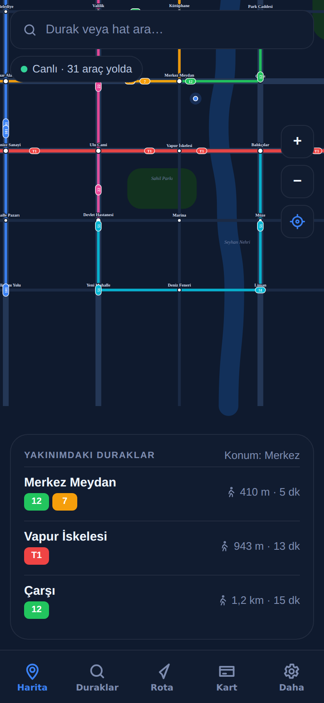

# Rota — Şehir İçi Toplu Taşıma Uygulaması

Otobüs ve tramvay hatlarını, durak varış tahminlerini ve rota planlamayı tek ekranda sunan mobil uygulama. **React Native + Expo**; iOS, Android ve web'de çalışır. Harita tamamen vektörel (react-native-svg) olarak çizilir, harici harita servisi gerekmez.



## Özellikler

- **Canlı harita** — Şematik şehir haritası (nehir, parklar, caddeler), 7 hat, 36 durak. 31 araç saniyede bir güncellenen konumlarıyla hat üzerinde hareket eder; sürükle-kaydır, yakınlaştır, konuma git. Durağa dokununca yaklaşan araçlar alt kartta görünür.
- **Durak varış tahmini** — Araç konumu, hat hızı ve durak bekleme sürelerinden hesaplanan ETA; "2 durak uzakta · canlı" bilgisi, doluluk göstergesi, araç yetersizse tarifeye göre tahmin.
- **Rota planlama** — Aktarma cezalı Dijkstra (biniş bekleme + aktarma süresi), yürüme bacağı ile "Konumum"dan planlama, toplam süre / aktarma / yürüme / ücret (aktarma indirimli), bacak bacak zaman çizelgesi, son aramalar.
- **Duraklar** — Türkçe karakter duyarsız arama (durak, semt, hat), favoriler, yakınımdakiler (mesafe ve yürüme süresi), semte göre liste, erişilebilirlik bilgisi.
- **Hat detayı** — Sıklık, sefer saatleri, uzunluk, tek yön süre; durak zinciri üzerinde canlı araç konumları ve yönleri; hat duyuruları.
- **Kentkart** — Bakiye, yükleme (200 ₺+ hediye bakiye), QR ile biniş simülasyonu, işlem geçmişi.
- **Daha** — Duyurular, hat listesi, düşük veri modu, büyük yazı, sıfırlama.
- **Kalıcılık** — Zustand + AsyncStorage (favoriler, son aramalar, kart, ayarlar).
- **Test** — Vitest ile 16 birim testi (geometri, simülasyon, ETA, planlama), Playwright ile web çıktısında 27 kontrollü uçtan uca akış ve 8 ekran görüntüsü.

## Teknolojiler

React Native 0.86, Expo SDK 57, Expo Router, TypeScript (strict), react-native-svg, Zustand + AsyncStorage, Vitest, Playwright.

## Çalıştırma

```bash
npm install
npx expo start          # QR kodu Expo Go ile okut
npm run web             # tarayıcıda
```

## Test

```bash
npm test
npm run export:web && node scripts/serve.mjs 8082
npm run test:e2e
```

## Yapı

```
src/data/city.ts        duraklar, hatlar, duyurular, harita dekorasyonu
src/lib/transit.ts      yol geometrisi, araç simülasyonu, ETA, Dijkstra rota planlama
src/lib/useClock.ts     saniyelik saat ve araç konumları
src/components/TransitMap.tsx  SVG harita (pan/zoom, hatlar, duraklar, araçlar)
src/store               Zustand (favoriler, kart, ayarlar)
app/(tabs)              Harita · Duraklar · Rota · Kart · Daha
app/durak/[id], app/hat/[id]
```

## Lisans

MIT
